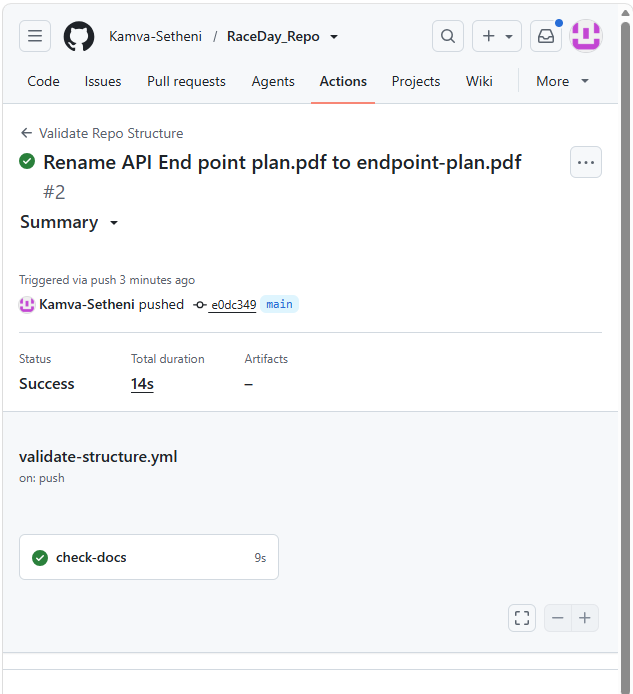
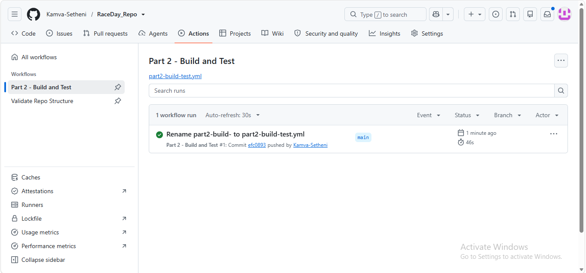

# RaceDay - Event Management System

RaceDay is a full-stack, API-driven event management platform for the South African road running, walking and cycling community. Event Organisers create and manage events, categories and results, while Participants browse events, enter races and track their personal performance.

This repository is built in three parts. **Part 1** (planning and database) and **Part 2** (RESTful API) are complete and documented below.

## User roles

- **Organiser** - can create, edit and delete their own events, manage the categories of those events, capture participant results, and view all enrolments for their events.
- **Participant** - can create an account, browse events and categories, enter an event by selecting a category, view and cancel their own enrolments, pay entry fees, and view their own results.

Role-based access is enforced at the API level. A Participant cannot use Organiser endpoints (403 Forbidden), and an Organiser cannot use Participant endpoints.

## Repository structure

```
/docs                         Part 1 - ERD, endpoint plan and SQL script
/Part2
  /RaceDay.Api                Part 2 - ASP.NET Core Web API (.NET 10)
    /Controllers              One controller per resource
    /Data                     EF Core DbContext (matches the Part 1 ERD)
    /Dtos                     Request/response models with validation
    /Helpers                  Role constants and session helpers
    /Migrations               EF Core migrations
    /Models                   Entity classes
    /Services                 Session authentication handler
  /RaceDay.Tests              xUnit tests (51 tests)
/.github/workflows            CI workflows (Part 1 structure check, Part 2 build and test)
```

---

## Part 1 - System planning and database

The planning documents are in `/docs`: `erd.png`, `endpoint-plan.pdf` and `raceday-schema.sql` (SQL Server script that creates and seeds the database).



**Part 1 video:** PASTE_PART1_VIDEO_LINK_HERE

---

## Part 2 - RESTful API

### Technology

ASP.NET Core Web API (.NET 10), Entity Framework Core (Code-First) with SQL Server, server-side sessions, BCrypt password hashing, Swagger (Swashbuckle) and xUnit.

### Prerequisites

- .NET 10 SDK
- SQL Server Express (instance `localhost\SQLEXPRESS`) and SQL Server Management Studio
- Visual Studio 2026 (optional)

### Setup and run instructions

1. Clone the repository:
   ```
   git clone https://github.com/Kamva-Setheni/RaceDay_Repo.git
   cd RaceDay_Repo/Part2/RaceDay.Api
   ```
2. Check the connection string in `Part2/RaceDay.Api/appsettings.json`. The default targets the local SQL Express instance:
   ```
   Server=localhost\SQLEXPRESS;Database=RaceDay;Trusted_Connection=True;TrustServerCertificate=True;
   ```
3. Create the database from the committed migration (install the EF tool once with `dotnet tool install --global dotnet-ef`):
   ```
   dotnet ef database update
   ```
   In Visual Studio you can run `Update-Database` in the Package Manager Console instead.
4. Run the API:
   ```
   dotnet run --launch-profile https
   ```
   If the browser warns about the development certificate, run `dotnet dev-certs https --trust` once.
5. Open Swagger in a browser at `https://localhost:<port>/swagger`. The port is printed in the console as `Now listening on`.
6. Register two users (one Organiser, one Participant), log in, and try the endpoints. Registering as an Organiser needs the organiser sign-up code `RACEDAY-ORG-2026` (set in `appsettings.json`).

### Authentication and sessions

- **Register** hashes the password with BCrypt. The original password is never stored.
- **Login** starts a **server-side session** that stores the user's ID and role. The browser only receives an HttpOnly session cookie (`.RaceDay.Session`).
- A small authentication handler (`SessionAuthenticationHandler`) reads the ID and role from the session on every request, so `[Authorize]` and `[Authorize(Roles = "...")]` protect the endpoints. Swagger UI sends the cookie automatically after login.
- **Logout** clears the session. Without a valid session, protected endpoints return **401 Unauthorized**; the wrong role returns **403 Forbidden**.
- **Organiser sign-up code:** anyone can register as a Participant, but registering as an Organiser needs the sign-up code, so users cannot simply pick the Organiser role.

### API endpoints (24)

| Method | Route | Role |
|---|---|---|
| POST | /api/auth/register | Public |
| POST | /api/auth/login | Public |
| POST | /api/auth/logout | Any logged in |
| GET | /api/users/me | Any logged in |
| PUT | /api/users/me | Any logged in |
| GET | /api/events | Public |
| GET | /api/events/{id} | Public |
| POST | /api/events | Organiser |
| PUT | /api/events/{id} | Organiser (owner) |
| DELETE | /api/events/{id} | Organiser (owner) |
| GET | /api/events/{id}/categories | Public |
| POST | /api/events/{id}/categories | Organiser (owner) |
| PUT | /api/categories/{id} | Organiser (owner) |
| DELETE | /api/categories/{id} | Organiser (owner) |
| POST | /api/categories/{id}/enrol | Participant |
| GET | /api/users/me/enrolments | Participant |
| GET | /api/events/{id}/enrolments | Organiser (owner) |
| DELETE | /api/enrolments/{id} | Participant (owner) |
| POST | /api/enrolments/{id}/results | Organiser (owner) |
| PUT | /api/results/{id} | Organiser (owner) |
| GET | /api/users/me/results | Participant |
| GET | /api/events/{id}/results | Public |
| POST | /api/enrolments/{id}/payment | Participant (owner) |
| GET | /api/users/me/payments | Participant |

### Changes from the Part 1 plan

The API follows the Part 1 endpoint plan. These deliberate differences are explained here:

| Area | Part 1 plan | Part 2 implementation | Reason |
|---|---|---|---|
| Event fields | name, description, eventDate, location | Adds `distance` and `eventType` (Run, Walk or Cycle) | The Part 2 brief requires every event to capture distance and type. The `Events` table in `raceday-schema.sql` and the ERD were updated to match. |
| Register | { fullName, email, password, role } | Adds optional `organiserCode`; returns 403 for an Organiser without a valid code | Stops users choosing the Organiser role freely. |
| Login | 200 OK returning a JWT | 200 OK returning the user and starting a server-side session | The brief requires session management. No JWT is used. |
| Logout | Not planned | POST /api/auth/logout | Needed to end a session. |
| GET /api/events | Lists upcoming events | Lists all events, soonest first | Past events and their results stay visible. |
| Extra status codes | - | 409 on duplicate profile email and duplicate result; 400 and 403 on payment | More precise failure responses. |
| Deleting events and categories | Removes related data | Also removes dependent enrolments, results and payments in code | Foreign keys use NO ACTION in the SQL script. |

### Unit tests

51 xUnit tests run the real API in memory with an in-memory database, so authentication, role checks and validation are tested end to end. Both success and failure scenarios are covered.

| Test class | Tests | Covers |
|---|---|---|
| AuthTests | 17 | Registration, login, logout, hashed passwords, session cookie, profile |
| EventTests | 14 | Organiser event and category management, ownership, validation |
| RoleAccessTests | 8 | Wrong role rejected (403), not logged in rejected (401), forged cookie, separate sessions |
| EnrolmentTests | 12 | Enrolment recorded and linked, duplicates (409), cancelling, results, payments |

Run them from the repository root:
```
dotnet test Part2/RaceDay.Tests/RaceDay.Tests.csproj
```

### CI/CD

The workflow `.github/workflows/part2-build-test.yml` runs on every push. It checks the Part 2 folder structure, builds the solution and runs all unit tests.



### Part 2 video

[(https://youtu.be/ADO-hm_i5Zs)
]
---

## References

Anthropic (2026) *Claude* [Large language model]. Available at: https://claude.ai (Accessed: 19 October 2026).

MDN Contributors (2026) *HTTP response status codes*. Available at: https://developer.mozilla.org/en-US/docs/Web/HTTP/Reference/Status (Accessed: 19 October 2026).

## AI acknowledgement

Generative AI (Claude, Anthropic) was used to assist with planning and drafting parts of this project, including the database design, API structure and code scaffolding. The code was reviewed, tested and is explained by the author in the video presentations.
